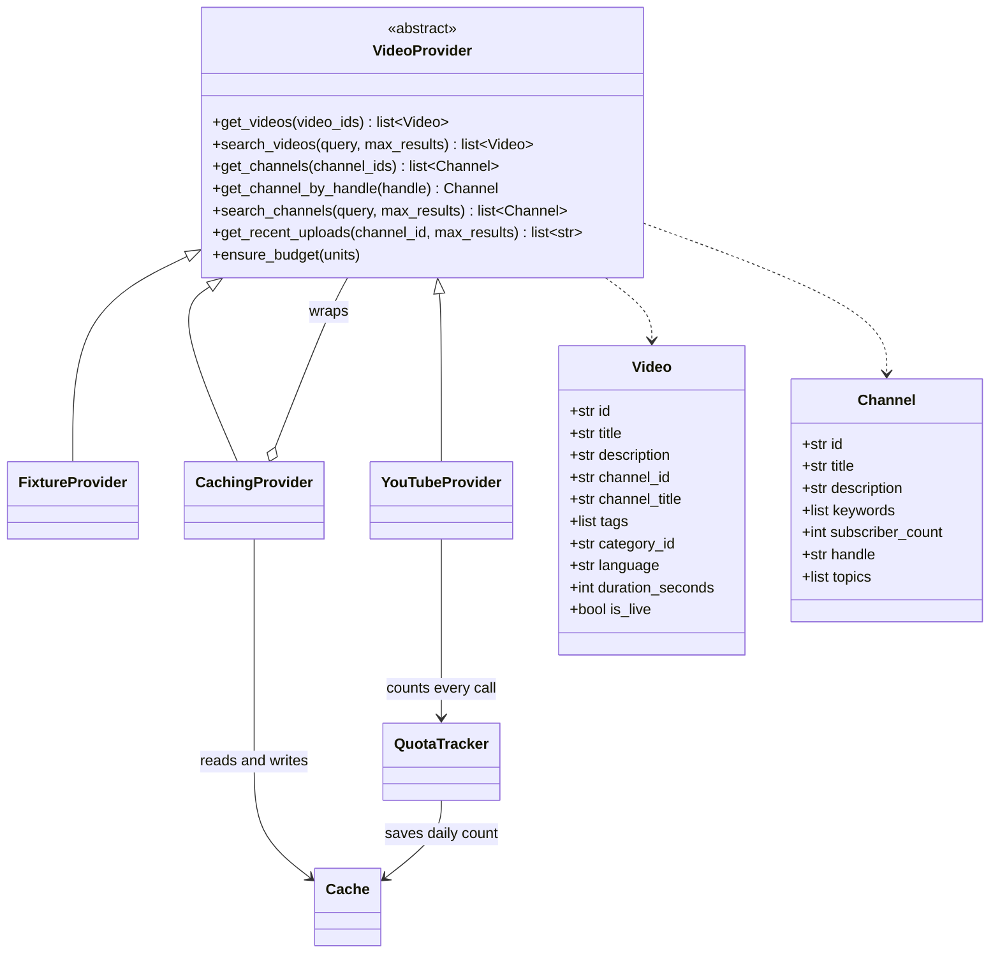
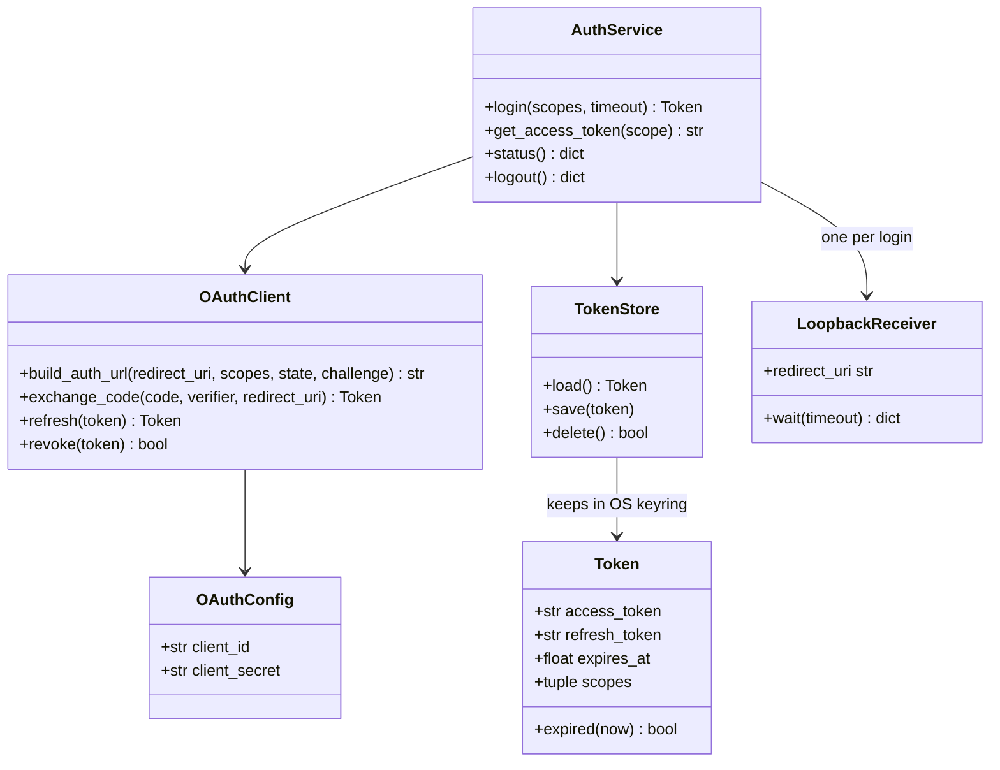
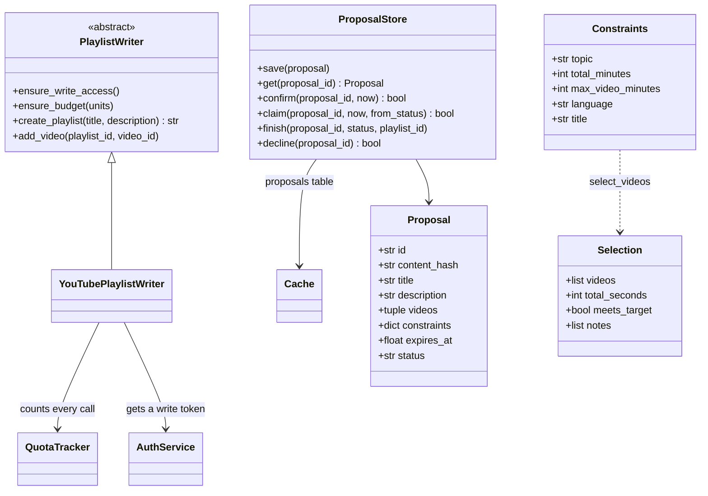

# Design Classes

Design document 2 of 4 (SE-2). Class diagrams of what exists in the code today.
Back to [[Design Components]].

## Providers, cache and data
`CachingProvider` wraps another provider and has the same interface, so services cannot tell them apart ([[ADR-005 SQLite cache]]).

## Sign-in (FR-6)
`AuthService` is the only thing later features call: `get_access_token()` returns a valid token or raises `AUTH_REQUIRED`.

## Playlists (FR-5)
The writer is separate from `VideoProvider`. It can only create ([[Playlist]]).

## Errors
Every error has a stable `code` and a `remediation` the tool returns to the AI client (UI-3). See [[Errors]].

```mermaid
classDiagram
  class YtmcpError {
    +code
    +remediation
  }
  YtmcpError <|-- VideoNotFoundError
  YtmcpError <|-- ChannelNotFoundError
  YtmcpError <|-- ApiKeyMissingError
  YtmcpError <|-- QuotaExceededError
  YtmcpError <|-- YouTubeApiError
  YtmcpError <|-- OAuthConfigError
  YtmcpError <|-- AuthRequiredError
  YtmcpError <|-- AuthFailedError
  YtmcpError <|-- InvalidConstraintsError
  YtmcpError <|-- NoVideosFoundError
  YtmcpError <|-- ProposalNotFoundError
  YtmcpError <|-- ProposalExpiredError
  YtmcpError <|-- ProposalMismatchError
  YtmcpError <|-- ProposalUsedError
  YtmcpError <|-- ConfirmationRequiredError
  YtmcpError <|-- WriteAccessRequiredError
  YtmcpError <|-- YouTubeChannelRequiredError
  YtmcpError <|-- PlaylistWritesDisabledError
```

The services and tools are plain functions, not classes (`find_similar_videos`, `find_similar_channels`, `similar_videos_tool`, `similar_channels_tool`), so they are not drawn here. Their flow is in [[Design Sequences]].
