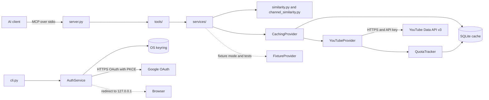

# Design Components

Design document 1 of 4 (SE-2). The others: [[Design Classes]], [[Design Sequences]], [[Design Data]].
The same layers in words: [[Architecture]].

## Components and how they connect
Everything runs as **one local process** on the user's computer. The AI client talks to it over MCP (stdio). Only two things leave the computer: calls to YouTube and calls to Google.

## What each part is for
| Part | Job | Code |
|---|---|---|
| MCP server | Registers the tools, nothing else | `src/ytmcp/server.py` |
| Tools | Check arguments, format results and errors (UI-1, UI-3) | `src/ytmcp/tools/` |
| Services | The feature logic (FR-1, FR-2) | `src/ytmcp/services/` |
| Similarity | Pure scoring maths, no API calls | `similarity.py`, `channel_similarity.py` |
| Providers | All YouTube access (SE-6) | `src/ytmcp/providers/` |
| Cache and quota | SQLite cache and the daily unit count (FR-7) | `cache.py`, `quota.py` |
| Auth | Google sign-in and token storage (FR-6) | `src/ytmcp/auth/` |
| CLI | `auth login`, `status`, `logout` (UI-4, partly) | `cli.py` |

## Rules this design keeps
- Services never call YouTube directly, only through `VideoProvider` ([[ADR-001 Provider interface]]).
- Tools never raise to the client: errors become `{code, message, remediation}` ([[ADR-003 Structured errors]]).
- The cache sits **in front of** the live provider and has the same interface ([[ADR-005 SQLite cache]]).
- Tokens only ever go to the OS keyring ([[ADR-007 OAuth with PKCE and keyring]]).
- Only stdio is used to talk to the AI client ([[ADR-009 Stdio transport only]]).

## Not built yet (planned)
FR-3 recommendations, FR-4 engagement analysis and FR-5 playlist creation will be new **services and tools** in the same layers. They add one more provider capability (reading the user's own data with the OAuth token) and a **proposal store**. See [[Design Sequences]] and [[Design Data]].
