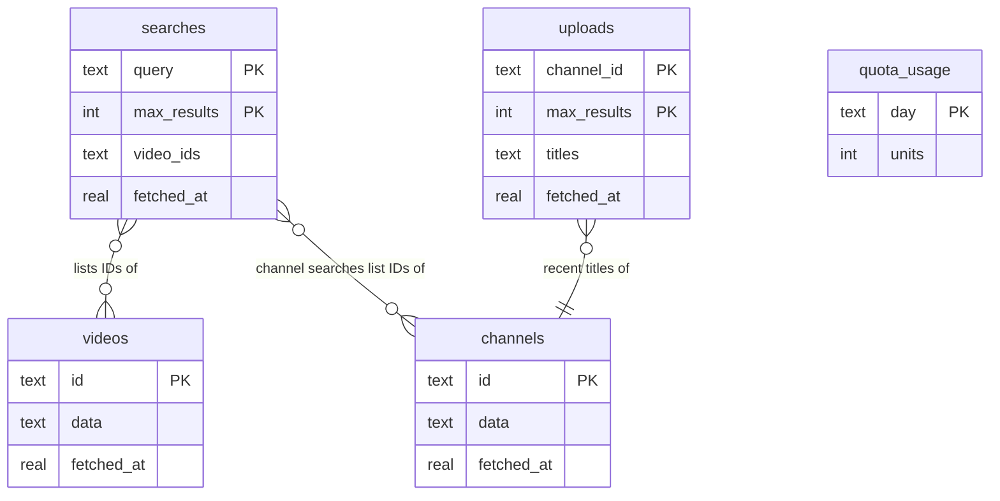
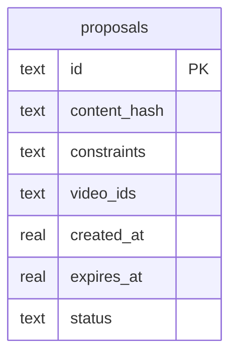

# Design Data

Design document 4 of 4 (SE-2). The ER diagram of the local database, and where every kind of data lives.
Back to [[Design Components]]. How the cache behaves: [[Cache]].

## Database (SQLite, WAL mode)
File `.cache/ytmcp.db`, created by `src/ytmcp/cache.py`. Metadata is stored as JSON text in `data`. The links between tables are logical (an ID inside JSON), not SQL foreign keys.

Notes:
- Channel searches use the `searches` table with the query written as `channel: <words>`, so they never clash with video searches.
- `quota_usage` has one row per Pacific-time day. It is the only table that is never expired ([[Quota]]).
- `prune` runs at startup and deletes rows older than their limit.

## Planned table (FR-5.4, not built)
Proposals are stored so the server can check them at confirmation time.

## How long data is kept
YouTube's API terms require refreshing or deleting stale data (SRS section 6).

| Data | Kept for |
|---|---|
| Video and channel metadata | 24 hours |
| Video and channel searches | 1 hour |
| Recent upload titles | 6 hours |
| Quota count | per day, small |
| Proposals (planned) | 15 minutes |

## Where each kind of data lives
| Data | Where | Why there |
|---|---|---|
| YouTube API key | `.env` (git-ignored) | read by the server at start |
| Google OAuth client ID and secret | `.env` (git-ignored) | identifies this app to Google |
| Google login tokens | **OS keyring only** | SRS 5.3: never in files, database, logs |
| Video, channel, search data, quota count | SQLite file | cache and ledger (FR-7) |
| Sample data for tests | `tests/fixtures/` | no live calls, no real user data (TQ-5) |

No real user data (likes, subscriptions, playlists) is stored anywhere yet. When FR-3 and FR-4 arrive, that data must stay in memory or in the cache with the same expiry rules, and never in fixtures or logs.
