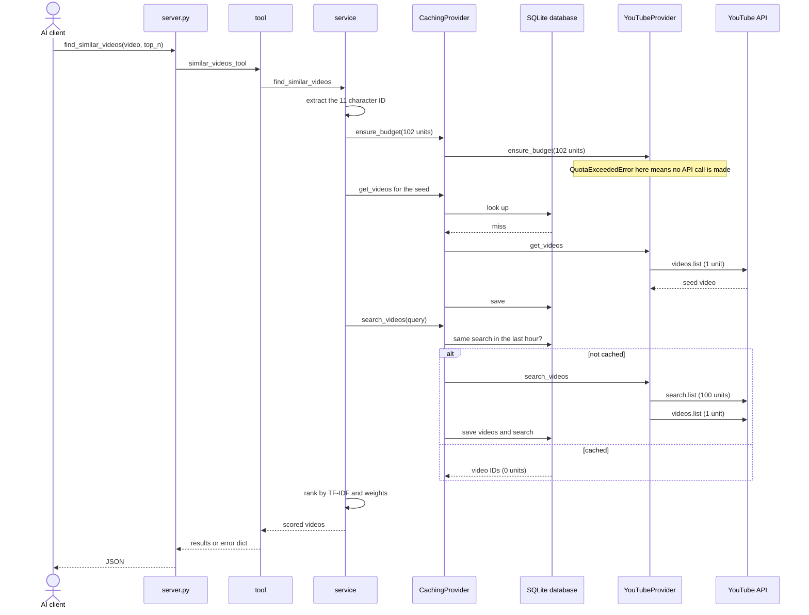
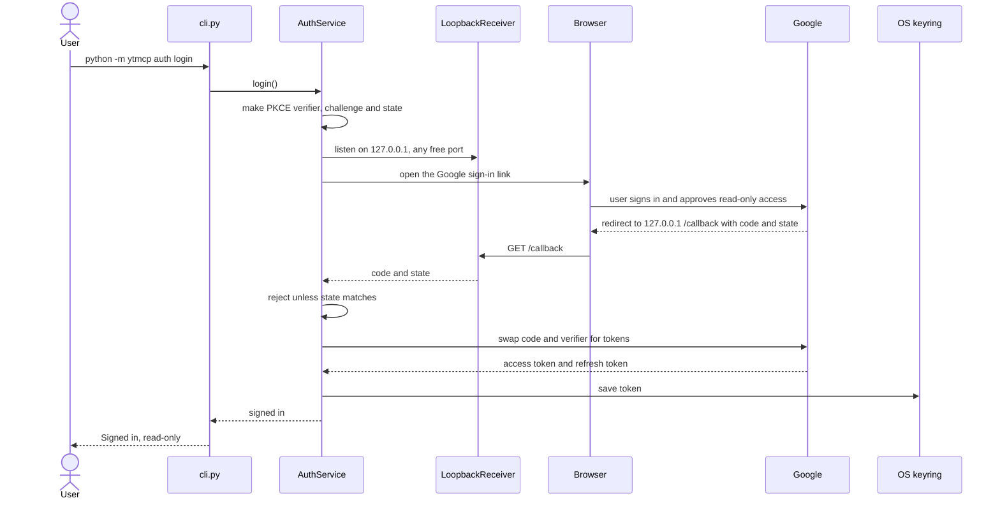
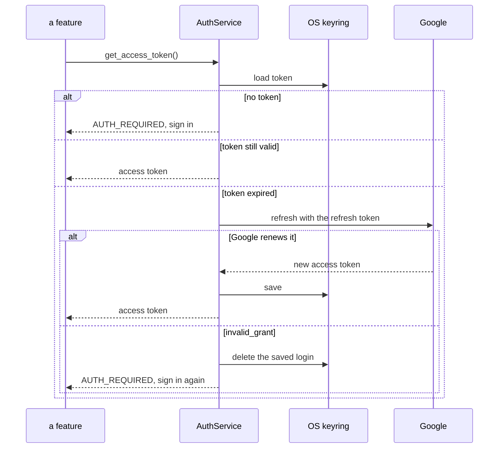
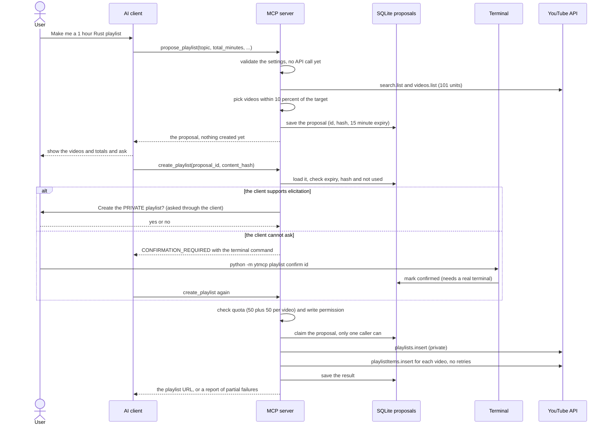
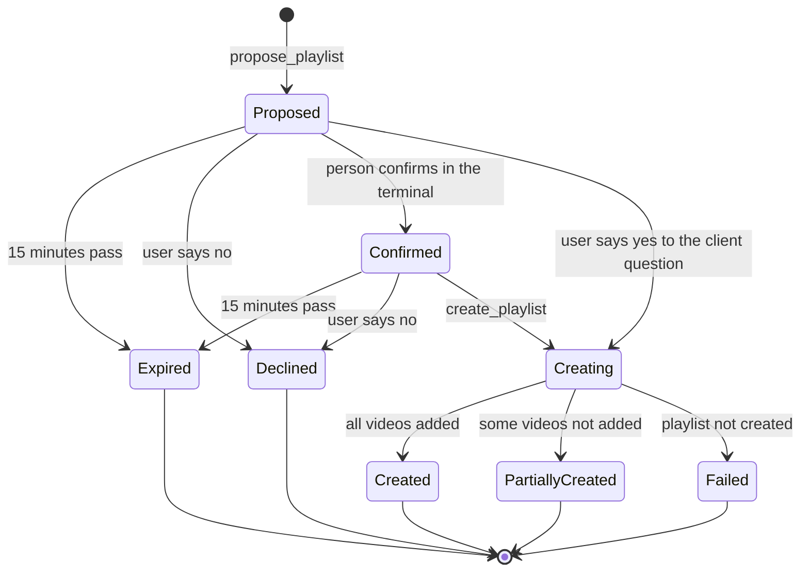
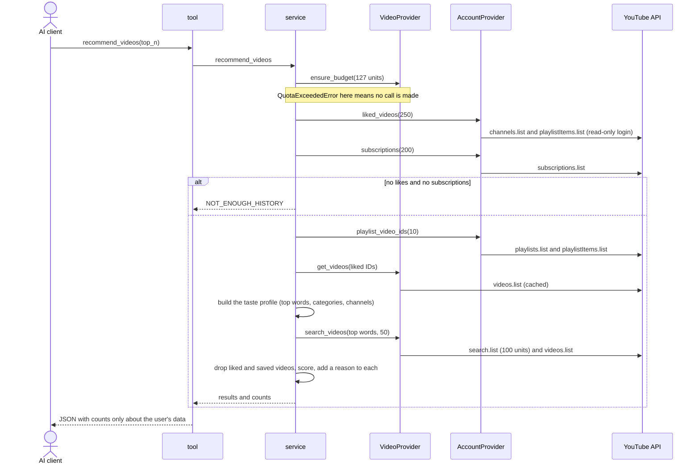
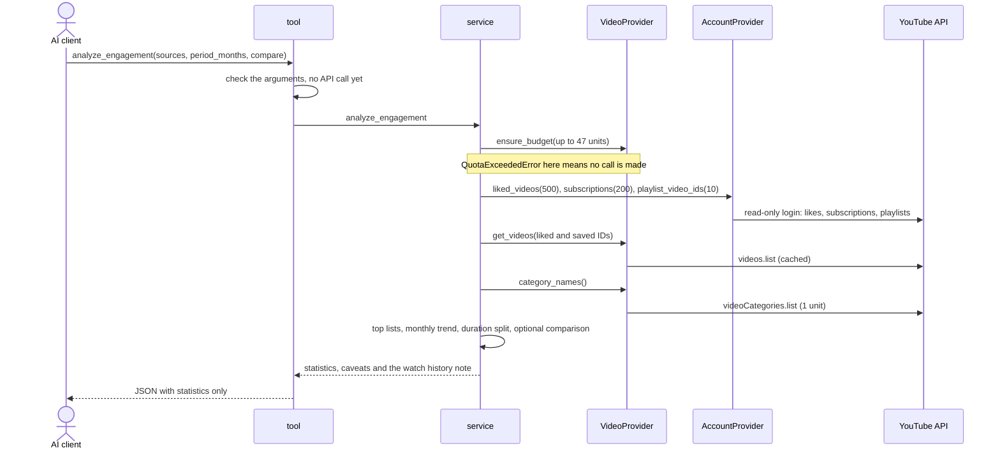

# Design Sequences

Design document 3 of 4 (SE-2). Who calls whom, in order.
Back to [[Design Components]]. Classes: [[Design Classes]].

## 1. Find similar videos (built, FR-1)
A cold request. With a warm cache the YouTube calls are skipped and it costs 0 units. `find_similar_channels` (FR-2) follows the same shape: see [[Channels]].

## 2. Sign in (built, FR-6.1)

## 3. Stay signed in (built, FR-6.2)
Later features call `get_access_token()`. The user is only asked to sign in again if Google refuses to renew (for example the 7 day Testing-mode limit).

## 4. Create a playlist (built, FR-5)
A person must approve, and the AI has no way to approve (FR-5.5). There are two ways a person confirms: the client asks the user, or the user confirms in a terminal. See [[ADR-013 Playlist creation needs a person's confirmation]] and [[Playlist]].

### Proposal states
No write to YouTube happens before `Creating`. A proposal can be used once.

## 5. Recommend videos (built, FR-3)
Reads the user's own account with the read-only login, builds a taste profile, searches once. See [[Recommendations]].

## 6. Analyse engagement (built, FR-4)
Reads only the sources the user chose, then works out statistics. See [[Engagement]].

