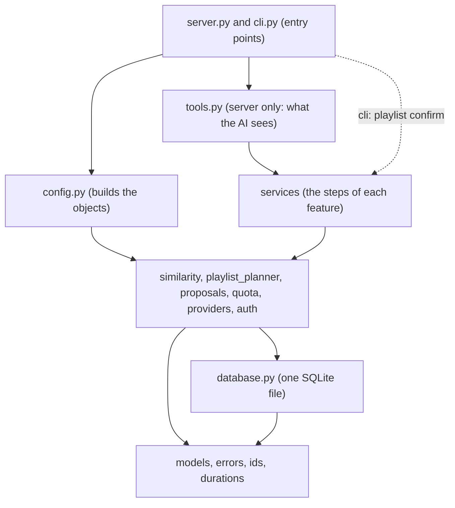

# Architecture Overview

One page to explain the whole server, for the viva. It describes the **final design**, after the cleanup and the features in [[Refactor and Feature Plan]]. Items marked (planned) do not exist yet. Today's layout is in [[Architecture]]; the detailed diagrams are in [[Design Components]], [[Design Classes]], [[Design Sequences]] and [[Design Data]].

## What it is
A local MCP server. An AI client (Claude and similar) calls its tools. The server answers using the official YouTube Data API, and, for a user's own data, the user's Google login. It runs on the user's computer and talks to the client over stdio.

## The one rule: imports only point down

The same thing as text. A file may import only from files lower in this list:
1. **Entry points:** server.py and cli.py. (cli.py imports server.py only inside its serve command, because both are entry points.)
2. **config.py and tools.py.** config.py reads .env and builds the objects. tools.py checks arguments and formats results and errors for the AI client.
3. **services:** the steps of each feature.
4. **Logic and access:** similarity.py, playlist_planner.py, proposals.py, quota.py, the providers, and auth.
5. **database.py:** the one SQLite file, with all the SQL.
6. **models.py, errors.py, ids.py, durations.py:** import nothing from above.

Two interfaces in the providers: **VideoProvider** for public data (API key) and **AccountProvider** for everything done as the signed-in user (login).

## One line per file
| File | Job |
|---|---|
| server.py | Registers the MCP tools, and asks the user to confirm a playlist |
| cli.py | The terminal commands: auth, playlist confirm, quota status, serve, local-check (some planned) |
| config.py (planned) | Reads settings, builds the provider, the account, the store and the auth service |
| tools.py (planned) | Checks arguments, formats results, turns errors into code, message, remediation |
| services: similar_videos, similar_channels | FR-1 and FR-2: find, then rank |
| services: playlists | FR-5: propose, then create after a person confirms |
| services: recommendations, engagement (planned) | FR-3 and FR-4 |
| similarity.py | Scoring for videos, channels and taste profiles (TF-IDF plus other signals) |
| playlist_planner.py | Checks playlist settings and chooses the videos. Pure rules |
| proposals.py | A saved playlist plan with a hash and a 15 minute expiry |
| quota.py | What each API call costs, and the daily budget |
| providers: base | The two interfaces |
| providers: youtube | All the YouTube HTTP code: reads with the API key, writes with the login |
| providers: caching | Wraps a provider and answers repeats from the database |
| providers: fixture | Sample data for tests and local checks |
| auth | Google sign-in (PKCE, local redirect), token storage in the OS keyring |
| database.py (planned name) | The SQLite file: cached data, the quota count, the proposals |
| models.py, errors.py, ids.py, durations.py | Plain data, errors with codes, ID parsing, time parsing |

## Walkthrough 1: find similar videos
1. The AI client calls find_similar_videos. tools.py checks the arguments.
2. The service extracts the 11 character ID from the ID or URL.
3. It asks the provider to check the budget: about 102 units. If that would go over the daily limit, it stops **before any API call**.
4. The caching provider looks the seed video up in the database. On a miss, the YouTube provider calls the API, and the result is saved.
5. It searches for candidates (100 units, or 0 if the same search was made in the last hour) and gets their details in one batch.
6. similarity.py scores each candidate, excluding the seed, and keeps the best few.
7. tools.py formats rank, title, channel, duration, score and URL. Any error becomes a code, a message and a fix.

## Walkthrough 2: create a playlist
1. propose_playlist checks the settings, searches once, chooses videos within 10 percent of the requested length, saves a **proposal** (ID, hash, 15 minute expiry) and returns it. Nothing is created.
2. The AI shows it to the user. Then it calls create_playlist with only the proposal ID and the hash.
3. The server checks that the proposal exists, is unused and unexpired, and that the hash matches.
4. A person must say yes: **either** the client asks the user directly, **or** the user runs `python -m ytmcp playlist confirm` in a terminal. There is no argument for the AI to approve it.
5. The server checks the quota (50 plus 50 per video) and that the login has write permission.
6. It claims the proposal in one database step (so it works once only), creates a **private** playlist, adds the videos, and reports any that failed. Nothing is retried.

## Safety rules
- A person must confirm every playlist, and the AI cannot confirm for them ([[ADR-013 Playlist creation needs a person's confirmation]]).
- Playlists are always private. The only writes are create playlist and add video. Nothing is edited or deleted.
- Writes are never retried, so a timeout cannot create a duplicate.
- Google login tokens live only in the OS keyring. They are never printed, logged, stored in the database or put in an error.
- The quota is checked before any API call, and reads and writes share one counter.
- Text from YouTube (titles, descriptions) is untrusted data: it is cut to one short line and the AI is told never to follow instructions inside it.
- Logins are read-only unless the user asks for write permission with `auth login --write`.

## Where data lives
| Data | Where |
|---|---|
| YouTube API key, Google OAuth client | .env (not in git) |
| Google login tokens | The OS keyring only |
| Cached videos, channels, searches, upload titles | The SQLite file, with an expiry (24 h, 1 h, 6 h) |
| The daily quota count | The SQLite file |
| Playlist proposals | The SQLite file (so the terminal command can see them) |
| Sample data for tests | tests/fixtures, never real user data |

## Why it is built this way (short answers)
1. **Why layers with imports pointing down?** Any file can be read from the bottom up, and a change in one layer cannot surprise a layer below it ([[ADR-015 Simple module layout and one-way imports]]).
2. **Why config.py?** Both entry points need the same objects. Putting the building in one file stops server.py and cli.py from importing each other.
3. **Why two provider interfaces?** Public data needs only an API key. Data about the signed-in user needs the user's login and write permission. Keeping them apart makes the dangerous one small ([[ADR-016 One AccountProvider for the signed-in user]]).
4. **Why database.py and not cache.py?** It is one SQLite file that also holds the quota count and the proposals, so "cache" was misleading.
5. **Why are writes never retried?** After a timeout the playlist may already exist, and a retry could make a duplicate.
6. **Why can the AI not confirm a playlist?** Text inside a video can influence the AI. If the AI could approve, injected text could create playlists. So a person answers a question from the server, or confirms in a terminal.
7. **Why TF-IDF and weights and not a trained model?** YouTube has no "related videos" call, so similarity is computed from metadata. TF-IDF is simple, free, deterministic and explainable ([[ADR-002 Metadata similarity]]).
8. **Why stdio only?** The server is single-user: one API key, one login, one keyring ([[ADR-009 Stdio transport only]]).
9. **Why an API key for some calls and OAuth for others?** A key can only read public data. Likes, subscriptions and playlists belong to a person and need their login ([[Auth]]).
10. **Why a SQLite cache?** A search costs 100 of the 10,000 daily units, so repeats should be free ([[ADR-005 SQLite cache]]).
11. **Why tests with fakes, and not live calls?** Live tests would spend quota, need a key in CI and fail when the network does. The real API was checked by hand at each step.
12. **Why a brain check and ADRs?** So the notes cannot rot, and every decision has a reason a new person can read ([[ADR-012 Brain checks in a standard library script]]).

Part of [[Architecture]].
